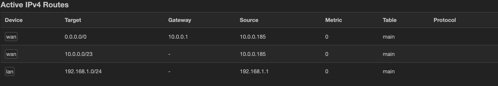

# Network Audit
### The plan:
First things first, we need to audit the hardware, OS, software, accounts and passwords, IP's and anything else neccecary.  Then, we can finish up by doing housekeeping, such as updating and patching software.  

### Hardware
- Netgear 8port ethernet switch
- Raspberry pi 4 as a router, running OpenWRT
- Server w/ 32gb ram, etc
- GL.Net wireless router running in AP mode

### Software
- OpenWRT as routing software.  

### IP's
- router's internal IP: 192.168.1.1
- router's external IP: 10.0.0.185 (likely to change, as it's acting as a regular DHCP client to the external network)
- AP: 192.168.1.113
- Switch: 192.168.1.202
- Macbook: 192.168.1.142
- Main server/homelab: 192.168.1.129

### Router settings
current routes

# Steps
- First, I tried connecting to the pi, since I should be able to access it both internally and externally, and use it as a jump server.  Unfortnetly nmap did not easily reveal it's external IP, and I could not get display out.  I then tried a different approach of connecting to the wifi network, and thankfully my laptop remembered the password.  When I connected, I had internet, so the router must have been working as intended.  
- Once inside the network, I used nmap to document the IP adresses of all the online hosts.  
- Then, I signed into the router to get it's external IP adress.   
- Then looking at static licenses in the router, I found the IP for the server, and it also confirmed for me what some of the devices online were.  
- I then logged onto the AP to verify it's passwords, and saved that and the router's account logins.  
- TODO: portscan from outside, investigate main server, and update EVERYTHING.  