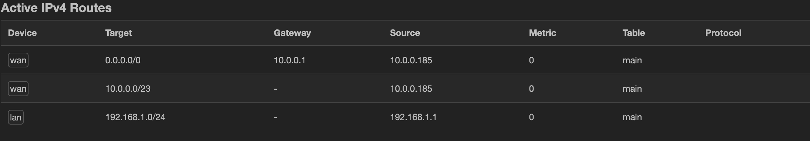
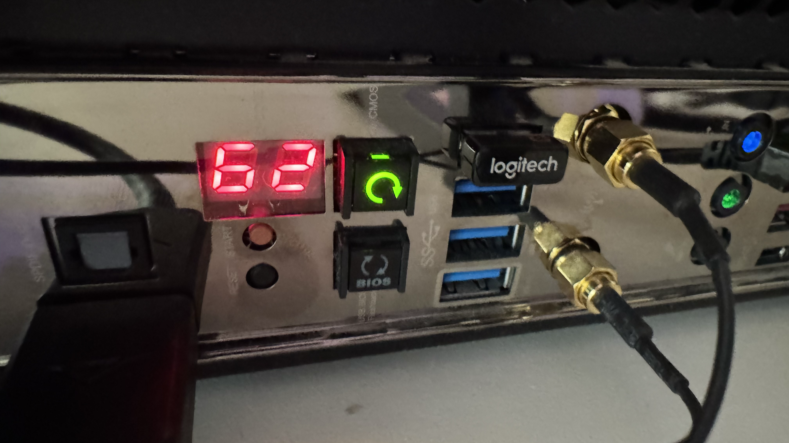
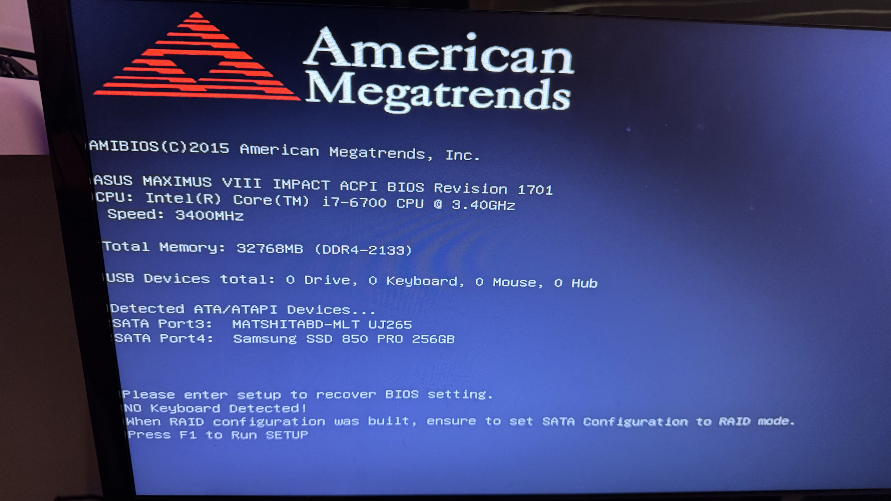
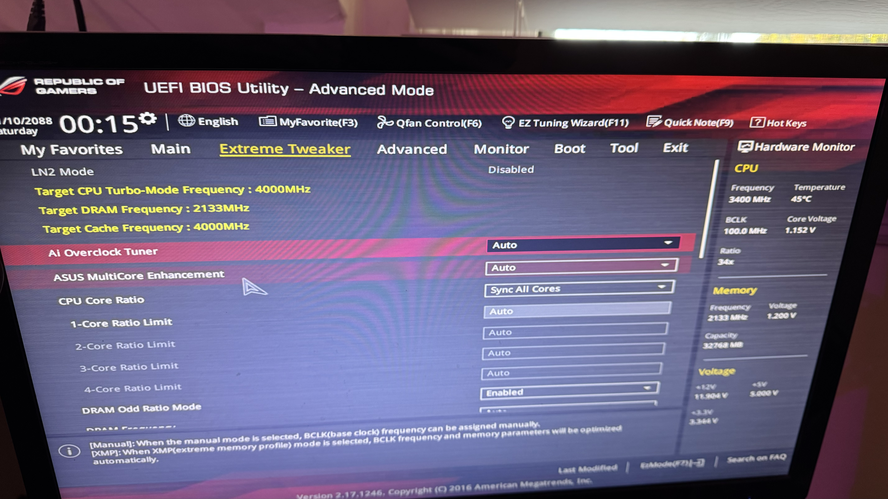
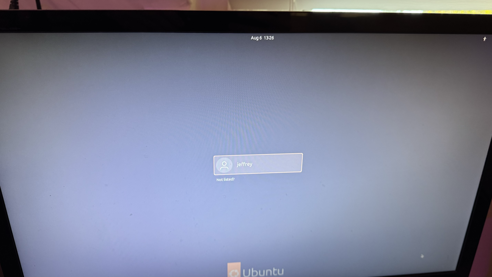
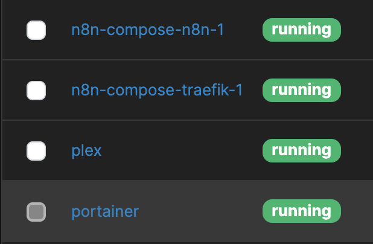

# Network Audit
### The plan:
First things first, we need to audit the hardware, OS, software, accounts and passwords, IP's and anything else neccecary.  Then, we can finish up by doing housekeeping, such as updating and patching software.  

### Hardware
- NetGear GS110TPv3 8-Port Gigabit Smart Managed Pro Switch with PoE+ and 2 SFP Ports
- Raspberry pi 4 as a router, running OpenWRT
- Custom built desktop PC/server with Intel i7-6700, 32GB DDR4, GeForce GTX 1060 6GB, 256GB Samsung SSD, 
- GL.Net wireless router running in AP mode

### Software
- OpenWRT as routing software.  

### IP's
- router's internal IP: 192.168.1.1
- router's external IP: 10.0.0.185 (likely to change, as it's acting as a regular DHCP client to the external network)
- AP: 192.168.1.113
- Switch: 192.168.1.202
- Macbook: 192.168.1.142
- Main server/homelab: 192.168.1.129

### Router settings
current routes

# Steps
- First, I tried connecting to the pi, since I should be able to access it both internally and externally, and use it as a jump server.  Unfortnetly nmap did not easily reveal it's external IP, and I could not get display out.  I then tried a different approach of connecting to the wifi network, and thankfully my laptop remembered the password.  When I connected, I had internet, so the router must have been working as intended.  
- Once inside the network, I used nmap to document the IP adresses of all the online hosts.  
- Then, I signed into the router to get it's external IP adress.   
- Then looking at static licenses in the router, I found the IP for the server, and it also confirmed for me what some of the devices online were.  
- I then logged onto the AP to verify it's passwords, and saved that and the router's account logins.  
- At this time, I unplugged everything and moved it to a different location for my convenince.  
- I couldn't establish a connection through nmap, ping, etc to the main pc, so I decided to connect a monitor to it using hdmi, but got no signal.  I tried both the motherboard and gpu ports, different monitor and cable.  I do hear the fans running.  
- One thought was misconfigured dhcp or internet settings.  When it's pulgged in, I do see flashing lights indicating data is being transmitted.  Remoting into the switch, i see that the pc has transmitted 7500 packets since the restart, opposed to the 40k and 50k for my ap and router.  This means that it is talking to the router in some way.  
- I deleted the static dhcp license but did not find any difference.  No difference noted.  restarted cmos from button on motherboard. 
- Claude told me to try `nmap -Pn -p 22,80,443,8006 192.168.1.129`, bypassing ping.  Still got nothing.  
- There is a screen with a 2 didget code on the motherboard, showing 99.  Claude says it's hung in Super I/O initilization.  I did have a keyboard usb dongle on, so I removed that.  Immedietly after reboot I got monitor output!  Then plugging the dongle back in, I was able to enter the ueif and reboot.  After that, ubuntu was loaded back up!  I was able to ssh in too!
<table>
  <tr>
    <td></td>
    <td></td>
  </tr>
</table>
<table>
    <tr>
        <td></td>
        <td></td>
    </tr>
</table>
- I then readded the static dhcp license.  
- Investigating the server, I see I have portainer managing docker on 192.168.1.129:9443.  Currently running are two services for n8n, plex, and ofc, portainer

- Last step is updating my OS and any software

# Conclusion
The network itself is in great shape.  The switch, router, and AP are working and functioning just as I would like.  

Although I have a decent docker setup with portainer, I think I want to move to proxmox.  Ubuntu has a lot of bloat that I have no use for as a server, and it just feels messy to be using a whole general use OS to host everything.  

Proxmox will allow me to seperate everything into clean installs, standardize backups, and start intigrating CI/CD and infrustructure as code easier.  

