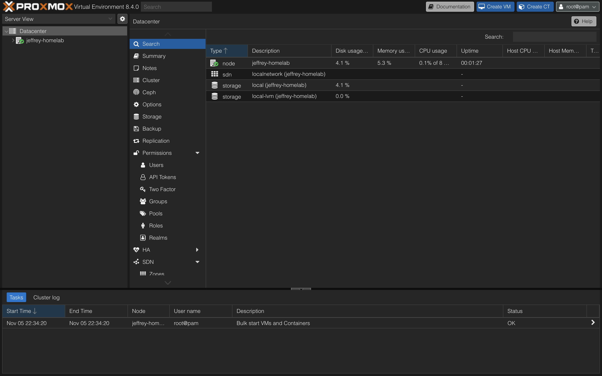

# Proxmox setup
### The plan:
1. **Install proxmox.**  I really don't care about about keeping what was on the ubuntu install, so we can skip backing up data
2. **Install basic systems.**  To validate functionality, I plan to create a basic vm with a minecraft server, and a basic plex instance.  
3. Install Uptime Kuma or similar system to have real time monitoring for everything.  

### Steps:
1. I start by grabbing my ventoy usb, and booted into the usb, then started the installer.  I configed the settings in the installer, which mainly consisted with setting a password.  Then all I had todo was wait for it to install and reboot.  
2. After a reboot, proxmox was live!
  
3. Trying to download an iso directly to proxmox, it gave me a dns error.  Sure enough, after pinging google.com, and 8.8.8.8, the domain failed but the IP went through.  DNS was pointing to my router like it should, so I thought it might be the routers fault.  However querying the nameservers using `dig` from my laptop did show me google's servers.  What's weirder is `dig` works on the proxmox shell too.  Just ping google.com doesn't work.  Changing my dns server to 8.8.8.8 fixed the problem however.  After a lot of troubleshooting with claude, I found that it was due to Linux sending two requests for the name, over ipv4 and ipv6.  My router was dropping one of them, leaving the ping request hanging.  Google's 8.8.8.8 handled the pair of requests perfectly, which is why it worked fine.  The fix was to add `options single-request-reopen` to `/etc/resolv.conf`.  
4. Once I had downloaded the iso, I was able to make my first VM!  I gave it 1cpu and 4gb of ram, and after taking a solid 30 minutes to install it was up!  
5. I installed puffer panel on the vm, which allows me to manage the minecraft servers through a web panel.  After creating the mc server on the panel, it worked perfect!  I now have my own mc server to use for whatever!  Once I figure out a reverse proxy or tunnel, any of my friends can play on it too!
6. After port forwarding in my router, anyone on my family's LAN or my persional LAN can connect.  